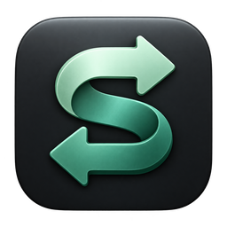
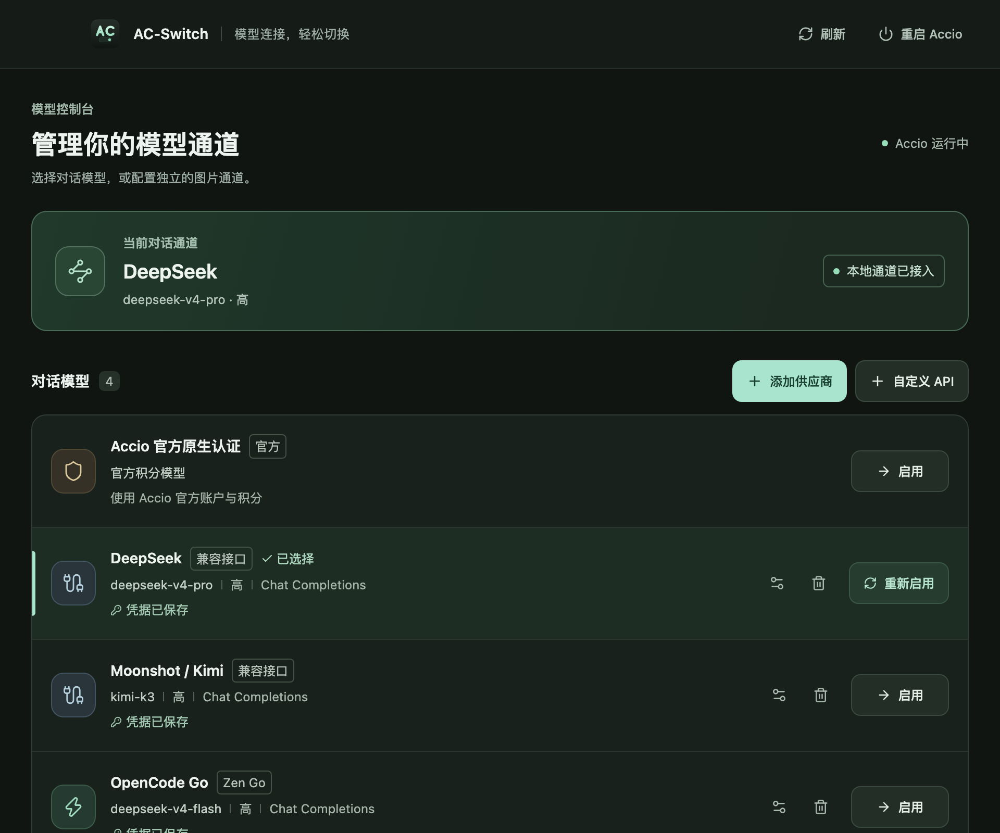

<div align="center">



# AC-Switch

### 给 Accio Desktop 换个模型

**Accio 里用 GPT、Claude、DeepSeek、Kimi，或者你自己的模型。**<br>
在一个窗口里添加供应商、一键切换，随时切回官方积分模型。

  [](LICENSE)

**[下载](https://github.com/Fuuuuuu502/AC-Switch/releases)** &nbsp;·&nbsp; **[Novaferry](https://novaferry.com/)** &nbsp;·&nbsp; **[更新记录](CHANGELOG.md)**

<br>



</div>

<br>

## 适合谁

Accio Desktop 默认只能用官方积分模型。AC-Switch 让它改用你自己的 API：

- **想用别的模型**：GPT、Claude、DeepSeek、Kimi、通义、智谱，或本地模型。
- **已经有 API Key**：填进去就能用，不用再买积分。
- **想随时切回官方**：官方模式一直在列表里，一键切换。

如果你只用 Accio 官方模型、积分也够用，就不需要它。

## 快速开始

**1 · 安装。** 从 **[Releases](https://github.com/Fuuuuuu502/AC-Switch/releases)** 下载：Mac 用 `.dmg`（Apple Silicon，macOS 13.5 及以上），Windows 用 `-setup.exe`（x64）。需要先装好 Accio Desktop。

**2 · 添加供应商。** 打开 AC-Switch，点「添加供应商」选一个预设，填入 API Key 保存。也可以直接用列表里的 Novaferry。

**3 · 启用。** 在供应商卡片上点「启用」，回到 Accio 就是新模型。想换回来，启用「Accio 官方原生认证」即可。

## 支持的供应商

| 供应商 | 说明 |
|---|---|
| **[Novaferry](https://novaferry.com/)** | 内置。令牌分组选 auto 后一个 Key 调用 GPT 和 Claude；Claude 只支持 Chat Completions |
| OpenCode Go | DeepSeek 系列 |
| OpenAI | GPT 系列 |
| DeepSeek | DeepSeek 开放平台 |
| 通义千问 | 阿里云百炼（北京） |
| 智谱 | GLM 通用 API |
| Moonshot / Kimi | Kimi 开放平台 |
| 自定义 | 任意 OpenAI 兼容接口（Chat Completions / Responses），包括本地模型 |

## 功能

- **一键切换**：在窗口或菜单栏托盘里切换供应商，Accio 已连接时直接生效。
- **模型和思考强度**：每个供应商可以选模型、调思考强度。
- **图片通道**：生图、改图可以单独指定模型和 Key，不占用对话模型。
- **随时恢复**：退出 AC-Switch 后，Accio 自动恢复官方连接。

## 隐私

API Key 只保存在你自己的电脑上：Mac 存在本机文件（仅本人可读）和钥匙串，Windows 用系统 DPAPI 加密。AC-Switch 没有自己的服务器，请求直接发往你选择的供应商。

## 从源码构建

需要 Node、pnpm 和 Rust。

```bash
pnpm install --frozen-lockfile
pnpm tauri dev      # 开发
pnpm tauri build    # 打包
```

## 说明

AC-Switch 是非官方项目，与阿里巴巴 / Accio 没有关联。使用第三方模型 API 时，请自行遵守 Accio 及各供应商的服务条款。Windows 版仍在测试中。

## 许可证

[AGPL-3.0](LICENSE)
